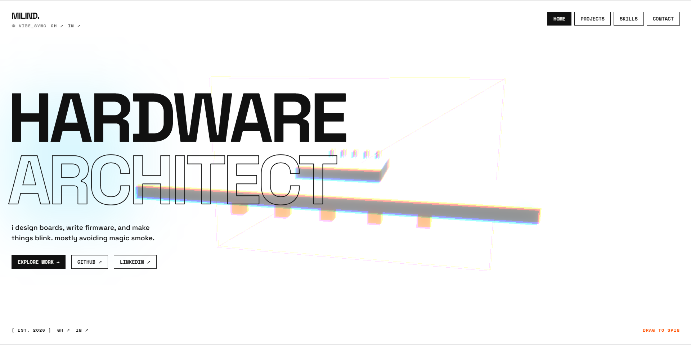

# Milind Singh — Portfolio

My personal portfolio website.

## Description

A simple personal website to showcase my hardware projects, circuit boards, and code. Built with an interactive 3D board in the background and click sounds as you browse through my work.

## Why did i build this

I like making stuff, from circuits to code, so I thought I'd make a place to share it all. Added some fun little details to make it less boring.

### Screenshots



## Getting Started

### Dependencies

* Node.js (v18 or higher)
* Modern web browser with WebGL support

### Installing

* Clone the repository:
```bash
git clone https://github.com/FBIopeningUPP/my-portfolio.git
cd my-portfolio
```
* Install dependencies:
```bash
npm install
```

### Executing program

* Run the development server:
```bash
npm run dev
```
* Build for production:
```bash
npm run build
```
